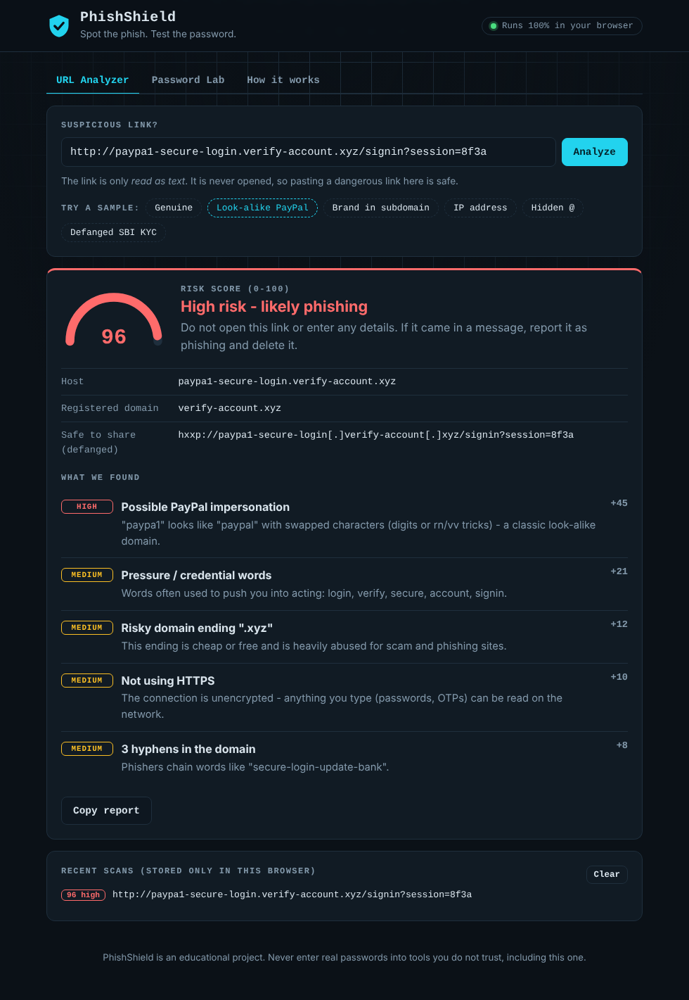
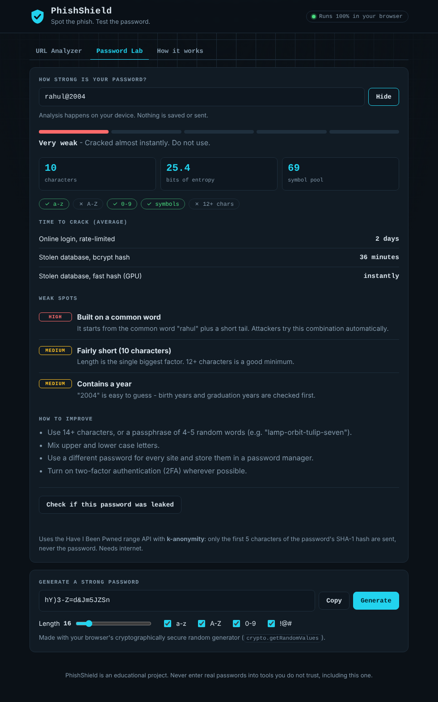

# PhishShield - https://phishshield-3-gtig.onrender.com

**A phishing URL analyzer and password security lab that runs entirely in your browser.**
The URL analyzer combines explainable phishing heuristics with a trained logistic-regression classifier. URL scoring runs locally; there is no analysis backend or database.



## Features

| Tool | What it does |
|------|--------------|
| **URL Analyzer** | Paste a link and get a combined 0-100 score, the separate ML phishing likelihood, and plain-English rule findings (look-alike domains, IP hosts, hidden `@`, punycode, risky TLDs, URL shorteners, brand impersonation, redirect tricks, pressure words). Understands defanged links like `hxxps://evil[.]com`. The link is **never opened or sent to a service**. |
| **Password Lab** | Live strength meter, entropy in bits, crack-time estimates for 3 attack models, weak-spot detection (common passwords, sequences, keyboard walks, years, leetspeak), and tips to improve. |
| **Breach check** | Checks the password against the Have I Been Pwned database using **k-anonymity**: only the first 5 characters of the SHA-1 hash leave your device. |
| **Generator** | Strong random passwords from `crypto.getRandomValues` with unbiased selection. |

Extras: scan history (kept in your browser's `localStorage`), copy-as-report, light/dark theme that follows your system, keyboard-accessible tabs, mobile friendly.



## Project structure

```
phishshield/
├── index.html              # page layout
├── css/style.css           # theme (dark + light)
├── js/
│   ├── urlAnalyzer.js      # phishing heuristics (pure logic, no DOM)
│   ├── urlMl.js            # URL feature extraction and browser inference
│   ├── urlModel.generated.js # trained model weights + evaluation metadata
│   ├── passwordAuditor.js  # entropy, patterns, breach check, generator
│   └── app.js              # connects the logic to the page
├── scripts/train_url_model.py # reproducible UCI model training (Python stdlib)
├── test/                   # 39 unit tests (node:test, no dependencies)
├── docs/                   # screenshots
├── .github/workflows/deploy.yml   # test + deploy to GitHub Pages
└── .vscode/                # Live Server + browser launch configs
```

The analysis modules are written so they work both in the browser and in Node, which is why they can be unit-tested without a browser.

## Run it in VS Code

1. Install [VS Code](https://code.visualstudio.com/) and open this folder: **File > Open Folder > phishshield**.
2. Install the **Live Server** extension (VS Code will suggest it automatically).
3. Right-click `index.html` and choose **Open with Live Server**. It opens at `http://127.0.0.1:5500`.

Other ways: press **F5** and pick *Open PhishShield in Chrome/Edge*, or simply double-click `index.html`. Everything works from a plain file, no server needed. (The breach check needs internet.)

### Run the tests

Needs [Node.js](https://nodejs.org/) 18 or newer. There is nothing to install.

```bash
npm test
```

## Push to GitHub

1. Create an **empty** repository named `phishshield` on <https://github.com/new> (do not add a README or licence there).
2. In the VS Code terminal (**Terminal > New Terminal**) inside the project folder:

```bash
git init
git add .
git commit -m "Initial commit: PhishShield"
git branch -M main
git remote add origin https://github.com/<your-username>/phishshield.git
git push -u origin main
```

Replace `<your-username>` with your GitHub username. If Git asks you to sign in, use the browser prompt or a personal access token.

## Deploy (free, with GitHub Pages)

The included workflow runs the tests and then publishes the site automatically on every push to `main`.

1. On GitHub open your repo > **Settings > Pages**.
2. Under **Build and deployment > Source** choose **GitHub Actions**.
3. Push any commit (or open the **Actions** tab and run the workflow manually).
4. After about a minute your site is live at:

```
https://<your-username>.github.io/phishshield/
```

Put this link in your project report and on the first slide.

*Alternative without Actions:* Settings > Pages > Source: **Deploy from a branch** > `main` / `(root)`. Delete `.github/workflows/deploy.yml` if you choose this.

## How it works

### URL analyzer

A hybrid scoring engine. The transparent rule score is capped at 100; a logistic-regression model trained on PhiUSIIL adds up to 35% influence when it raises the final score. Rule checks never lower the risk score. The UI shows the rule score and ML phishing likelihood separately. The model receives 22 lexical and structural URL features only; it does not fetch the URL or see page content.

Training uses the [UCI PhiUSIIL Phishing URL dataset (ID 967)](https://archive.ics.uci.edu/dataset/967/phiusiil%2Bphishing%2Burl%2Bdataset), licensed CC BY 4.0. The training script downloads the source archive on demand and does not save or commit raw URLs. It uses hostname-hash-based 80/10/10 train, validation, and holdout splits to keep each host in one partition; generated model metadata includes validation and holdout metrics. Features are recomputed from the raw URL field so the model does not rely on page-content columns unavailable during scans. The model uses class-balanced training and prior-adjusts the displayed estimate; it is a research signal, not a calibrated threat-intelligence verdict.

Current hostname-held-out results: validation F1 81.13%; holdout accuracy 86.98%, precision 99.27%, recall 69.72%, and F1 81.91% (17,871 holdout samples). Metrics use the class-balanced 0.45 decision threshold. This is one fixed benchmark split, not a guarantee of live performance; the generated model records the full summary.

To retrain (Python 3, no third-party packages needed):

```bash
npm run train:model
```

The command regenerates `js/urlModel.generated.js`. Keep `scripts/train_url_model.py` and `js/urlMl.js` feature definitions in sync.

Each rule that fires adds points, and the rule total is capped at 100:

| Score | Verdict |
|-------|---------|
| 0-29 | Low risk |
| 30-54 | Suspicious |
| 55-100 | High risk, likely phishing |

Some of the techniques:

- **Registered domain extraction.** `login.paypal.com.evil.tk` is owned by `evil.tk`, not PayPal. The browser reads a hostname from right to left, and so does the analyzer.
- **Look-alike detection.** Digits and letter pairs are mapped back (`1`/`l`/`i`, `0`/`o`, `rn`/`m`, `vv`/`w`), and Levenshtein edit distance catches single-typo domains such as `gooogle.com`.
- **Brand list.** Well-known brands (including Indian banks, UPI apps, IRCTC, UIDAI) are compared against their genuine domains.
- **Homograph attacks.** International characters that mimic Latin letters are converted to `xn--` punycode by the URL parser, which the analyzer flags.

### Password lab

```
entropy (bits) = sum over characters of log2(size of character pool)
```

Characters that belong to a sequence (`abcd`), a repeat (`aaaa`), a keyboard walk (`qwerty`) or a year (`2004`) are counted as only 1-2 bits each. If the password is a common word plus a short tail, the entropy is capped at the cost of guessing that word from a dictionary. Average crack time = half the search space divided by guesses per second:

| Attack model | Speed |
|--------------|-------|
| Online login with rate limiting | 100 guesses / second |
| Stolen database, bcrypt | 10,000 / second |
| Stolen database, fast hash on GPU | 10 billion / second |

### Privacy and security design

- All analysis runs client-side. There is no server and no analytics.
- The URL is only parsed as text, never requested.
- User input is written to the page with `textContent`, never `innerHTML`, so a crafted link cannot inject script (XSS).
- Passwords are never stored or logged. Only scanned URLs are saved in `localStorage`, and the history can be cleared.
- Breach check uses k-anonymity, so the password and even the full hash stay on your device.
- Random numbers use `crypto.getRandomValues` with rejection sampling to avoid modulo bias.

## Limitations

- Rules and ML can be wrong in both directions. A low score does not prove a site is safe. The trained dataset is a research benchmark; performance can change on newer campaigns and domains.
- The model uses URL-only features recomputed from a dataset that includes corresponding web pages. It cannot verify a page, domain reputation, registration age, or live status.
- No live data: domain age, SSL certificate details and reputation feeds are out of scope. For those use Google Safe Browsing or VirusTotal.
- Entropy is an estimate. Words that are not in the small built-in dictionary (for example a rare name) are not detected, so such passwords can look stronger than they really are.
- The list of brands is small and hand-written.

## Ideas for future work

- Add more brands and a larger password dictionary.
- Show the unicode form of punycode domains and detect look-alikes of brand names in them.
- Optional Google Safe Browsing lookup through a small backend.
- Browser extension that checks links on hover.
- A "phishing quiz" mode for awareness training.

## Possible viva questions

**What is phishing, and why is it dangerous?**
It tricks people into giving credentials or money by imitating a trusted site. It attacks the human, so antivirus and firewalls often cannot stop it.

**Why does your tool not open the URL?**
Opening an unknown link can run exploits or confirm to the attacker that the address is active. Reading it as text is safe.

**What is k-anonymity in the breach check?**
We hash the password with SHA-1 and send only the first 5 characters. The service returns every leaked hash with that prefix (hundreds of them) and we look for our full hash locally. The server cannot tell which one was ours.

**Why SHA-1 if it is considered broken?**
The Have I Been Pwned dataset is keyed by SHA-1. Here it is used only for lookup, not for protecting anything, so collision weaknesses do not matter.

**Is entropy a perfect measure?**
No. It assumes random choice from the character pool. Human-chosen passwords are predictable, so we reduce the estimate for patterns and dictionary words.

**What is a homograph attack?**
Using characters from other alphabets that look identical to Latin letters, for example Cyrillic "a" in `apple.com`. Browsers convert such names to `xn--` punycode, which the tool flags.

**Why is HTTPS not a guarantee of safety?**
HTTPS only encrypts the connection. Anyone, including a phisher, can get a free certificate, so the padlock proves privacy, not honesty.

**How would you improve accuracy?**
Refresh and independently evaluate the classifier on temporally newer URLs, add carefully governed reputation feeds, and consider domain-age and certificate signals through a privacy-preserving backend.

## Tech

HTML5, CSS3 (custom properties, grid, `color-mix`), vanilla JavaScript (ES2020), Python standard library for reproducible logistic-regression training, Web Crypto API, `node:test` for testing, GitHub Actions and GitHub Pages for CI/CD.

Dataset citation: Prasad, A. & Chandra, S. (2024). *PhiUSIIL Phishing URL (Website)*. UCI Machine Learning Repository. DOI: [10.1016/j.cose.2023.103545](https://doi.org/10.1016/j.cose.2023.103545). CC BY 4.0.

## Licence

MIT, see [LICENSE](LICENSE). This is an educational tool and comes with no warranty.
